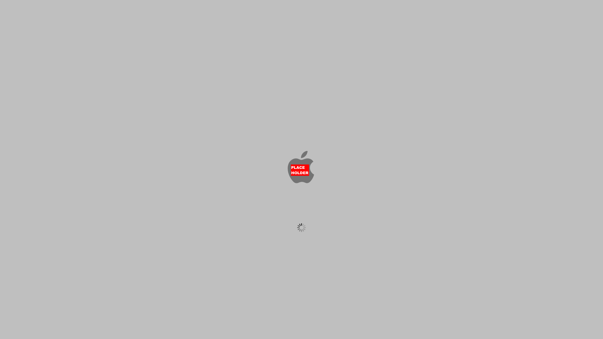

# BootPanel

The lynxOS boot panel — a plymouth-alike splash that owns the display from
early boot until the desktop takes over.

On the panel (short-lived machine state, so everything is fixed):

- **Background `#BFBFBF`** across the whole display — the same color the art
  plates are baked at, so sprites land seamlessly.
- **Logo, centered** in the display (128×128 art), `assets/logo.png`.
- **Spinner, centered** — 12 frames (`assets/spinner/00–11.png`, 30×30), one
  revolution per second by default; centered horizontally, and vertically
  its **center sits 185 px below the display height center**
  (`BOOTPANEL_SPINNER_OFFSET_Y` in `src/bootpanel.h`).
- Runs until `SIGINT`/`SIGTERM`, then restores the console and exits — the
  display then belongs to whatever starts next.



## Display backends

Two backends, picked at runtime:

1. **KMS/DRM** (preferred, built when libdrm is available): modesets dumb
   buffers on the first connected display and page-flips two of them; needs
   master (root or `video`), as plymouth does.
2. **Legacy fbdev** (always built; the fallback): mmaps `/dev/fb0` into
   whatever mode is already running. `--fbdev` forces it; 32/24/16 bpp are
   handled through the r/g/b bit offsets from fbdev itself.

When everything ends, `KD_GRAPHICS` is undone and the real fbdev crtc is
restored — the screen returns to the boot console if the desktop never came.

## Baked-in assets

No filesystem reads, no libpng at runtime: the art is compiled into the
binary. `tools/genassets.py` (python3, stdlib only) decodes
the files in `assets/` to raw pixels and regenerates **`src/assets_embed.c` /
`assets_embed.h`**, which is committed and built in. After touching the pack:

```sh
make assets && make
```

## Building

```sh
make          # KMS when libdrm is present; make KMS=0 forces fbdev-only
make install  # -> /sbin/bootpanel
```

No runtime dependencies: the binary links only libc (plus -ldrm when the
KMS backend is compiled in).

## Usage

```sh
bootpanel                    # KMS/DRM, else legacy fbdev (auto)
bootpanel --fbdev            # force the legacy backend
bootpanel --kms --device=/dev/dri/card1
bootpanel --interval=60      # ms per spinner frame (default 80)
```

And, without any display backend (regression shots, e.g. for docs):

```sh
bootpanel --screenshot=boot.ppm [--width=1280 --height=800] [--frame=3]
```

## Repository layout

| | |
|---|---|
| `src/bootpanel.h` | the panel spec: colors, spinner offset, backend interface |
| `src/bootpanel.c` | layout/draw, tty coop (`KD_GRAPHICS`) |
| `src/main.c` | arguments, backend selection, the animation loop |
| `src/backend_kms.c` | KMS/DRM dumb buffers + page flip |
| `src/backend_fbdev.c` | legacy `/dev/fb0` |
| `src/assets_embed.c` | baked art (generated, committed) |
| `assets/` | the art pack the executable is generated **from** |
| `tools/genassets.py` | assets/ → src/assets_embed.c |

## lynxOS integration (planned)

`rootFSBuilder` gets to ship `/sbin/bootpanel`, started by the right boot
stage and stopped once SystemUIServer is up. That wiring lands with the
bootable-image work.

## License

MIT — see `LICENSE`.
